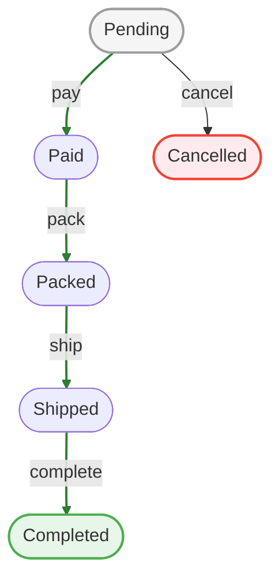

# Order Workflow

An order workflow is the canonical example for this plugin.

Typical states:

- `pending`
- `paid`
- `packed`
- `shipped`
- `completed`
- `cancelled`

Typical transitions:

- `pay`
- `pack`
- `ship`
- `complete`
- `cancel`

## Diagram

The happy path (green) runs `pay → pack → ship → complete`; `cancel` branches off to a failed state.



::: tip
After defining these states and transitions, `bin/cake workflow show order --mermaid` and the [View Helper](/integration/view-helper)'s `diagram()` generate a diagram from the definition. Initial, final and failed states receive distinct styling, and happy-path transitions are highlighted.
:::

## Good Practices

- keep transition names action-oriented
- use `reason` for cancellation or exceptional flows
- mark terminal failure states explicitly
- store operator identity in transition context

## Example

```php [src/Workflow/Order/State/PendingState.php]
#[Transition(to: PaidState::class, name: 'pay', happy: true)]
#[Transition(to: CancelledState::class, name: 'cancel')]
class PendingState extends BaseOrderState
{
    #[Guard('pay')]
    public function ensureHasPositiveTotal(): bool|string
    {
        return (float)$this->getEntity()?->get('total') > 0
            ? true
            : 'Order total must be positive';
    }
}
```

## Triggering transitions from code

Button labels should map to transition names defined by the workflow. For the
example above, payment uses `pay`. Authorize the order in your application before
running the transition:

```php [src/Controller/OrdersController.php]
public function pay(int $id): \Cake\Http\Response
{
    $this->getRequest()->allowMethod(['post']);
    $orders = $this->fetchTable('Orders');
    $order = $orders->get($id);
    $result = $orders->getBehavior('Workflow')->transition($order, 'pay', [
        'reason' => 'Payment captured',
    ]);

    if ($result->isSuccess()) {
        $this->Flash->success('Payment recorded.');
    } else {
        $this->Flash->error('Payment could not be recorded.');
    }

    return $this->redirect(['action' => 'view', $id]);
}
```

`transition()` checks guards and persists the new state. A separate `can()` call
can help render available actions, but execution must still check its result:
another request may have changed the entity since the page was rendered.
